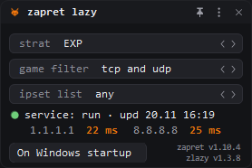

# zlazy

Автопилот и виджет для [zapret-discord-youtube](https://github.com/Flowseal/zapret-discord-youtube). Сам zapret, его стратегии и режимы остаются прежними. zlazy берёт на себя всё, что в оригинале делается руками: запуск, обновление, подбор стратегии, перепроверку и реакцию на VPN. А то, что происходит, показывает в компактном виджете.

## Что делает за вас

| В оригинальном zapret | В zlazy |
|---|---|
| Запустить `service.bat`, выбрать стратегию | Стартует сам с Windows, ещё до входа в систему |
| Следить за релизами и обновлять вручную | Проверяет обновления сам и ставит их, не трогая ваши списки |
| Запустить тест, прочитать результат, выбрать лучшую | Тестирует и включает лучшую стратегию без участия |
| Вспомнить, что пора перепроверить | Перепроверяет по расписанию, даже если компьютер не перезагружают |
| Выключать zapret перед VPN и включать после | Сам встаёт на паузу при VPN и возвращается после |
| Заметить, что обход упал | Сторож перезапускает его за 10 секунд |

## Автоматика

**Запуск.** Движок стартует при загрузке Windows от имени SYSTEM. Он не ждёт ни входа в систему, ни окна. Если сеть поднимается не сразу (Wi-Fi, медленный роутер), он ждёт её столько, сколько нужно, и не завершается с ошибкой.

**Обновление zapret.** Проверка идёт при каждом запуске, раз в сутки и после пробуждения компьютера. Новый релиз Flowseal скачивается и проверяется до установки: подпись драйвера WinDivert, безопасная распаковка, только GitHub по TLS. Если что-то не так, остаётся прежняя версия. Ваши `lists\` (домены, IP, `*-user.txt`), `targets.txt` и режим Game Filter переносятся в новую версию байт в байт.

**Подбор стратегии.** zlazy прогоняет стратегии тем же способом, что тест из оригинала, и сам включает лучшую. Чтобы не ждать несколько минут:

- **быстрый старт:** сначала проверяется стратегия, выбранная в прошлый раз. Если она проходит все проверки, обход работает примерно через 20 секунд, без перебора остальных;
- **замер без обхода:** если сеть и так всё открывает, перехват вообще не включается.

**Расписание без перезагрузки.** Проверки стратегий можно запускать при каждом запуске Windows, раз в 2–3 дня, раз в неделю или раз в месяц. Движок сверяет расписание раз в час, пока работает. Режим «при запуске» срабатывает и после пробуждения из сна дольше 30 минут: для вас это тоже «включил компьютер». Между проверками сразу запускается запомненная стратегия.

**Пауза при VPN.** Когда интернет идёт через VPN-туннель (Wintun, WireGuard, TAP, OpenVPN, xray/Happ и другие), обход не нужен, а тесты измеряли бы туннель. zlazy останавливает обход. Если VPN включили посреди теста, тест прерывается. После отключения VPN (5 секунд подряд без туннеля) zlazy возвращает прежнюю стратегию. VPN в режиме прокси, без туннеля, не обнаруживается.

**Переезд с оригинала.** Установщик сам находит папку `zapret-discord-youtube*` в `D:\progs`, `D:\`, `C:\progs` или `C:\`. Из неё один раз забираются ваши списки и режимы Game Filter и IPSet. Работающие zapret и GoodbyeDPI останавливаются, чтобы два перехватчика не делили трафик. Папка оригинала не меняется.

## Виджет

Небольшая тёмная карточка у края экрана и значок в трее с тем же состоянием.

- **Состояние одной строкой:** работает и когда обновлялся, ход проверки `testing 7/21 — …`, пауза `vpn: on · lazy paused` или ошибка. Значок состояния всегда стоит на одном месте.
- **Пинг** до 1.1.1.1 и 8.8.8.8, версии zapret и zlazy.
- **Переключатели прямо в карточке:** стратегия (только из прошедших все проверки), режимы Game Filter и IPSet из оригинала, расписание проверок. Изменения применяются сразу, без повторного теста. Выбранная вручную стратегия запоминается до следующего тестирования и переживает перезагрузку.
- **При загрузке** виджет показывает ход проверки и сам прячется через 5 минут после её окончания. Его можно закрепить.
- **Меню:** перепроверить сейчас, журналы, отчёты о проверках, показать или скрыть, выход.

Виджет работает без прав администратора. Все действия он передаёт движку, а тот принимает только команды из белого списка.

## Установка

1. Скачайте `zlazy-setup.exe` из последнего релиза.
2. Запустите и подтвердите права администратора.
3. Проверьте папку установки и папку оригинального zapret (подставляются сами) и нажмите «Установить» или «Обновить».

Удаление — через тот же установщик. Постоянная служба Windows не создаётся: обход работает только пока запущен zlazy.

## Важно

- Во время проверок и переключения стратегий возможны короткие перерывы сети.
- Некоторые антивирусы предупреждают о WinDivert. Скачивайте zlazy только из релизов этого репозитория.
- Результат зависит от сети и провайдера: универсальной стратегии нет.

## Лицензия

Собственный код — [MIT](LICENSE). Условия сторонних компонентов — в [THIRD_PARTY_NOTICES.md](THIRD_PARTY_NOTICES.md).

zlazy — неофициальный проект. Он не связан с авторами zapret-discord-youtube (Flowseal), zapret (bol-van) и WinDivert. В пакетах zlazy нет их бинарников: официальный релиз zapret скачивается с GitHub при первом запуске и остаётся под своей лицензией.
